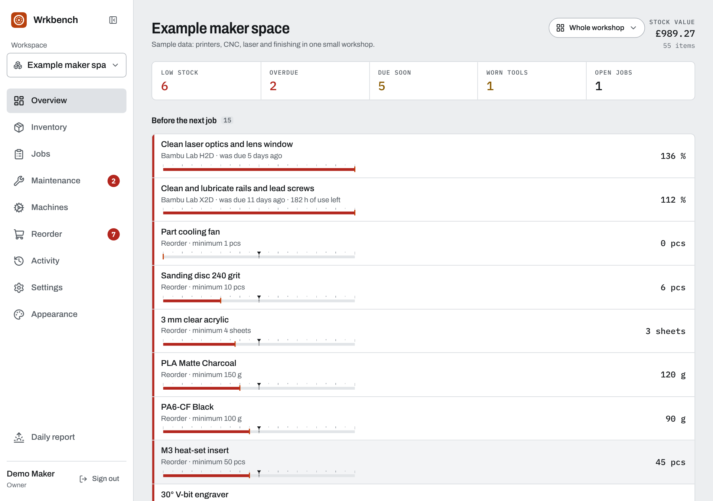

# Wrkbench

**Know what is in stock, where it is, and what needs attention.**

Wrkbench is a free, self-hostable web app for running a workshop: a maker space, a home workshop, a school lab or a small fabrication business. It tracks your materials and tooling, your machines and their maintenance, and the jobs you run on them, and tells you each morning what needs doing.

It started as a 3D printing filament tracker, which is why this repository is called `filament-tracker`. It now works for any kind of workshop: the categories, fields, units, machines and maintenance schedules are all things you set up, not things built into the code.



## What you can do

- **Track stock**: filament, sheet stock, endmills, screws, anything, with the details that matter for each kind. See exactly what is low and what to reorder, grouped by supplier. → [Inventory](docs/wiki/Inventory.md)
- **Look after your machines**: see what is fitted to each machine and what is loaded in it, down to which spool is in which feeder slot. → [Machines](docs/wiki/Machines.md)
- **Never miss servicing**: recurring maintenance by date, by hours of use, or both. → [Maintenance](docs/wiki/Maintenance.md)
- **Run jobs**: queue work per machine by priority. Finishing a job takes its materials out of stock, wears down tooling, and records what it cost. → [Jobs and the queue](docs/wiki/Jobs-and-queue.md)
- **Take requests from outside**: share a link so students or customers can send files for a job, then follow its progress without an account. → [Job requests](docs/wiki/Job-requests.md)
- **Start each day with a plan**: a daily report of what is overdue, short or running low, and an activity log where stock mistakes can be undone. → [Dashboard and reports](docs/wiki/Dashboard-and-reports.md)
- **Work as a team**: owners, admins, operators and viewers, each allowed to do what their role needs. → [Members and roles](docs/wiki/Members-and-roles.md)
- **Add real products in one step**: a built-in catalogue of printers, lasers, CNC machines, filaments, sheet stock, endmills and fasteners. → [Catalogue and settings](docs/wiki/Catalogue-and-settings.md)
- **Connect Bambu Lab printers**: see each AMS and the spools in it live, and link them to your stock. Read-only: it never controls a printer. → [Connecting printers](docs/wiki/Connecting-printers.md)
- **Keep your data**: export a workspace as JSON, or your stock as a spreadsheet, and import from CSV. → [Backups, import and export](docs/wiki/Backups-and-data.md)

It works on phones as well as computers, and can be installed as an app from the browser.

## Try it on your computer

You need [Node.js](https://nodejs.org) 22.9 or newer and [Git](https://git-scm.com).

1. Get the code:

   ```bash
   git clone https://github.com/hussxin5046/filament-tracker.git
   ```

   ```bash
   cd filament-tracker
   ```

2. Create your settings file by copying the example:

   ```bash
   cp server/.env.example server/.env
   ```

3. Open `server/.env` in a text editor and change two lines:
   - `JWT_SECRET`: replace it with a long random string. This command prints one:

     ```bash
     node -e "console.log(require('crypto').randomBytes(32).toString('base64'))"
     ```

   - `SEED_PASSWORD`: choose a password (at least 8 characters) for the demo account.

4. Install everything and create the database with sample data:

   ```bash
   npm run setup
   ```

5. Start it:

   ```bash
   npm run dev
   ```

6. Open <http://localhost:5173> and sign in with `demo@workshop.test` (the `SEED_EMAIL` in `server/.env`) and the password you chose. You will find a fully set-up example maker space to explore. You can also create your own account and start a new workspace from a template.

Stop it with <kbd>Ctrl</kbd>+<kbd>C</kbd>. Next time, `npm run dev` is all you need.

## Guides

The full documentation is in the [wiki](docs/wiki/Home.md), also available under the [Wiki tab](https://github.com/hussxin5046/filament-tracker/wiki).

| Using Wrkbench | Connected printers | Running your own copy |
| --- | --- | --- |
| [Getting started](docs/wiki/Getting-started.md) | [Connecting printers](docs/wiki/Connecting-printers.md) | [Self-hosting](docs/wiki/Self-hosting.md) |
| [Inventory](docs/wiki/Inventory.md) | [AMS and spools](docs/wiki/AMS-and-spools.md) | [Troubleshooting](docs/wiki/Troubleshooting.md) |
| [Machines](docs/wiki/Machines.md) | [Bridge reference](docs/wiki/Bridge-reference.md) | [Contributing](CONTRIBUTING.md) |
| [Maintenance](docs/wiki/Maintenance.md) | | |
| [Jobs and the queue](docs/wiki/Jobs-and-queue.md) | | |
| [Job requests](docs/wiki/Job-requests.md) | | |
| [Dashboard and reports](docs/wiki/Dashboard-and-reports.md) | | |
| [Members and roles](docs/wiki/Members-and-roles.md) | | |
| [Catalogue and settings](docs/wiki/Catalogue-and-settings.md) | | |
| [Backups, import and export](docs/wiki/Backups-and-data.md) | | |
| [Glossary](docs/wiki/Glossary.md) | | |

## Host it for your workshop

Wrkbench is one Node.js program that keeps its data in a SQLite file, so it needs no separate database. The included `Dockerfile` builds the whole app into one image: run it on any host with a persistent disk, set a secret and your site's address, and put HTTPS in front of it. [Self-hosting](docs/wiki/Self-hosting.md) covers Docker and plain Node.js, every setting, email and backups.

## Not built yet

Following prints as jobs automatically, working out filament used per job from the sliced file, sending jobs to printers, smart scales and sensors, QR and barcode scanning and label printing, other makes of connected machine, and AI suggestions.

## Contributing and support

- **Found a bug or have an idea?** [Open an issue](https://github.com/hussxin5046/filament-tracker/issues/new/choose).
- **Want to work on the code or the docs?** Read [CONTRIBUTING.md](CONTRIBUTING.md).
- **Found a security problem?** Please report it privately, as described in [SECURITY.md](SECURITY.md).

## License

Copyright (c) 2026 Husain Alaswad. Wrkbench is free software, licensed under the [GNU Affero General Public License v3.0](LICENSE) (AGPL-3.0-only). If you run a modified version as a network service, you must offer its users the corresponding source. Third-party licences are listed in [THIRD-PARTY-NOTICES.md](THIRD-PARTY-NOTICES.md).
