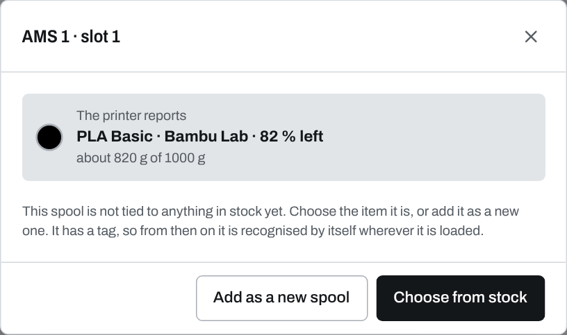

# AMS and spools

What you get on the **Machines** page once a printer is [connected](Connecting-printers.md), and how the spools in its AMS get tied to items in stock.

## What appears by itself

For each connected printer, Wrkbench creates and keeps up to date:

- **One piece of attached hardware per AMS** (AMS, AMS Lite, AMS 2 Pro, AMS HT), with the right number of slots. An outside spool holder appears the first time something is on it.
- **Readings**: humidity (or the printer's 1 to 5 dryness scale on models that only give that) and temperature. A drying AMS shows "Drying, about 3 h left".
- **What is in each tray**: material, type (for example "PLA Basic"), colour, and for tagged spools the brand and how much is left.
- **Which tray is feeding** during a print, marked with an orange edge.

These units say "read from the printer". Their slot count cannot be edited and they cannot be deleted while the printer is connected, because the printer would put them straight back.

If you had already entered an AMS by hand on that machine with the same number of slots, Wrkbench takes it over rather than making a second one, and keeps what you had loaded in it.

## Tagged and untagged spools

Bambu Lab's own spools carry a tag (RFID) that the AMS reads. Everything else does not.

| | Tagged spool | Untagged spool |
| --- | --- | --- |
| Printer knows | Material, type, colour, size, percent left, and exactly which spool it is | Only the material and colour set on the printer |
| First time loaded | One tap to link or add it | One tap to link or add it |
| Every time after | Loaded into its slot by itself, wherever you put it | Stays linked while it sits there; link again after it has been swapped |

## Linking a spool: the one tap

A slot that says **Not linked to stock** holds a spool Wrkbench has not been told about.

1. On **Machines**, tap the slot.
2. The dialog shows what the printer reports.
3. Choose one:
   - **Choose from stock**: pick the item this spool is. The list puts the best matches first (same material and a close colour are marked "matches what the printer reports").
   - **Add as a new spool** (admins): opens the usual item form already filled in with name, material, colour, brand, size and how much is left. Check it, add a price or location if you like, and save. It is placed in the slot for you.

If the spool has a tag, linking teaches Wrkbench that tag. From then on that spool is recognised by itself in any slot of any connected printer.

Operators can link spools from stock. Adding a new item needs an admin, as it does everywhere else.

## Taking a spool out

When a tray has been empty for about half a minute, its slot is unloaded. (The wait is there because trays can briefly read as empty while the AMS is checking a tag.) Unloading never changes stock.

## When Wrkbench leaves things alone

- **Your choice stands until the spool changes.** If you load a slot by hand, the printer's reading does not override it. Only when the tray physically holds something else does the slot follow the printer again.
- **A swap to something that could still be the same item keeps the link.** Same material and nearly the same colour counts as the same spool. A different material, or a clearly different colour, unloads the slot so you can link the new one.
- **A tag always wins.** If the printer reads a tag that belongs to a known item, that item is loaded, even over a manual choice.
- **One item is only ever in one slot.** Loading it somewhere moves it.

Each automatic load or unload is written to **Activity** with the printer's name as who did it.

## How much is left

For tagged spools the printer reports a percentage, in whole percent (about 10 g steps on a 1 kg spool). Wrkbench shows it but does not change your stock figure by itself.

When the printer's figure and your stock disagree, the slot dialog offers **Set stock to N g**. It is an ordinary stock adjustment: it shows in the item's history and in Activity, and an admin can undo it. Operators are offered it only when it lowers the figure, as with any stock change they make.

Automatic deduction per print is planned with job tracking; until then, use this button or log usage on jobs as before.

## When the printer is not reporting

The grey panel says why and how old the figures are:

| It says | Meaning |
| --- | --- |
| **Bridge offline** | The bridge program is not connected. Figures are the last ones it sent |
| **Printer not reachable** | The bridge is running but cannot reach the printer (off, asleep, or off the network) |
| **Needs access code** | The bridge has no working code for this printer. Enter it under **Settings**, **Printers**, **Access code** |
| **Waiting for the printer** | Connected a moment ago; nothing heard yet |

Slots keep showing what was last seen. Nothing is unloaded because a printer or bridge went quiet.
