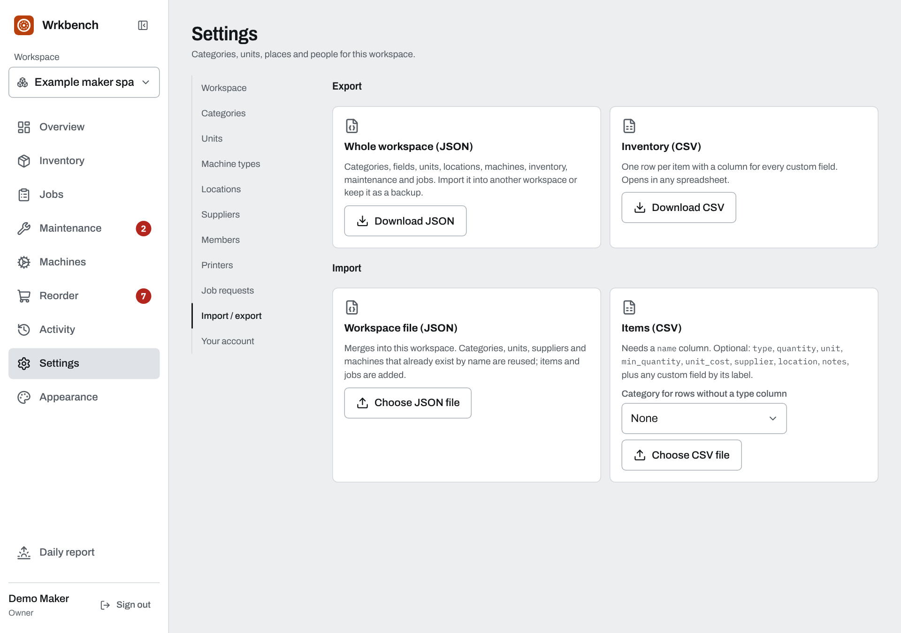

# Backups, import and export

Everything is under **Settings**, **Import / export**. Exporting is open to every member; importing needs an admin.

## Export

| Export | What you get | Use it for |
| --- | --- | --- |
| **Whole workspace (JSON)** | Categories and their fields, units, suppliers, locations, machine types, machines and their attached hardware, inventory, maintenance tasks and their service history, and jobs | A backup you keep yourself, or copying a workspace into another one |
| **Inventory (CSV)** | One row per item, with a column for every custom field | Opening your stock in a spreadsheet |

The workspace export does **not** include members, the activity log, job requests and their uploaded files, or connected printers.

## Import a workspace file

**Workspace file (JSON)** merges a file exported from Wrkbench into the current workspace. Categories, units, suppliers and machines that already exist with the same name are reused; items and jobs are added as new.

To start fresh from a backup, create a new blank workspace and import the file into it.

## Import items from a spreadsheet

**Items (CSV)** adds items from a CSV file, which any spreadsheet program can save.

- The file needs a `name` column.
- Optional columns: `type` (the category), `quantity`, `unit`, `min_quantity`, `unit_cost`, `supplier`, `location`, `notes`, plus any custom field by its label (for example `Colour` or `Diameter`).
- Choose a **Category for rows without a type column**.

The easiest way to get the columns right is to export your inventory as CSV first and use that file as a template.

## Keeping a real backup

The JSON export covers one workspace and leaves some things out (see above). If you run Wrkbench yourself, the complete backup is the server's data folder, which holds the database and every uploaded file. See [Self-hosting](Self-hosting.md#backups).

If someone else runs Wrkbench for you, ask them how it is backed up, and export your workspace now and then as well.
