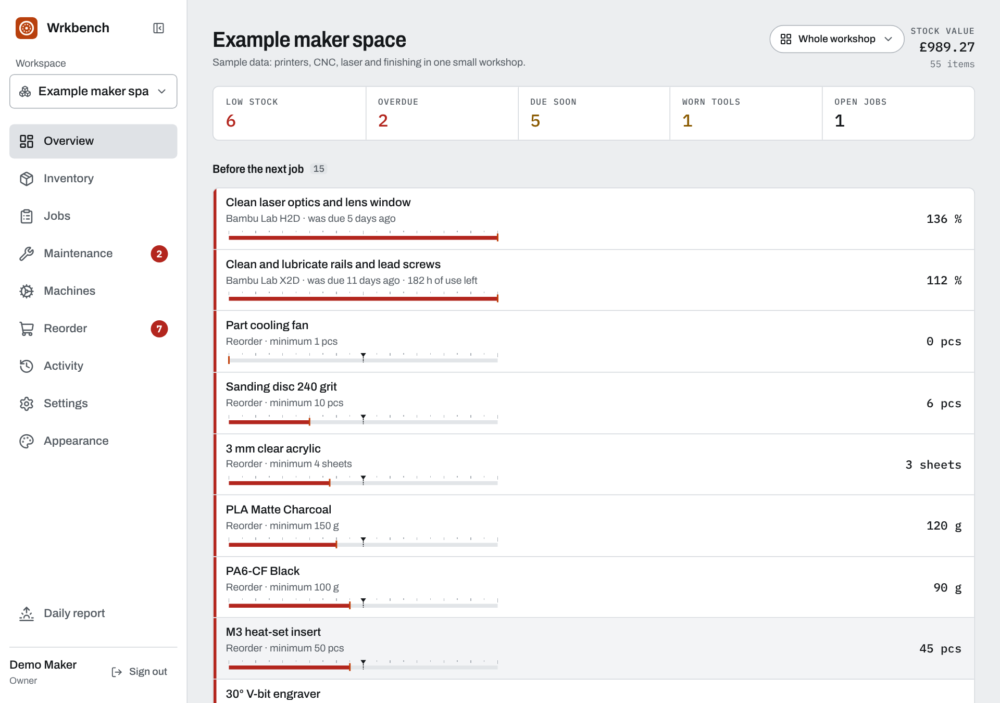
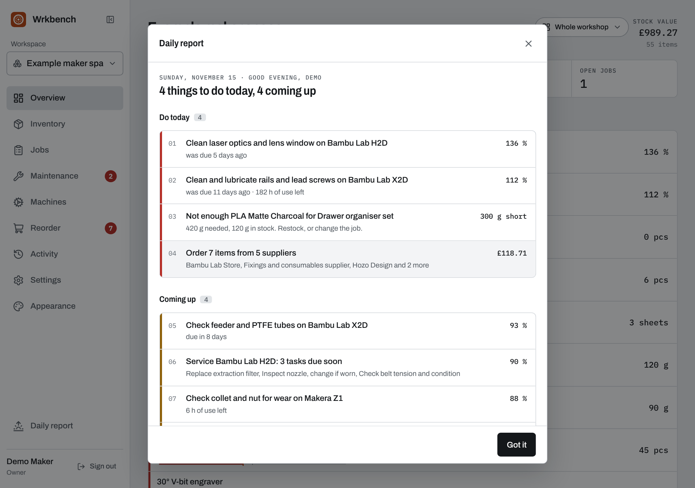
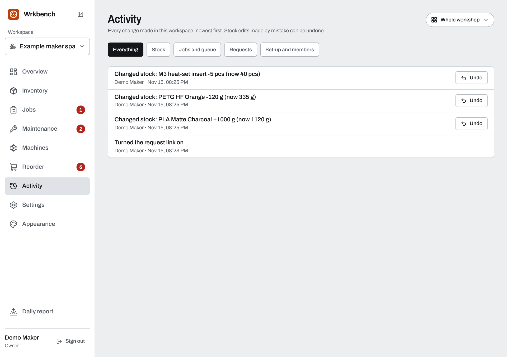

# Dashboard and reports

Three places tell you what is going on in the workshop: the **Overview** screen, the **daily report**, and the **Activity** log.

## Overview

The top row counts what needs attention: **Low stock**, **Overdue** and **Due soon** maintenance, **Worn tools** and **Open jobs**. The stock value of everything in the workspace is shown at the top right.

**Before the next job** lists the most pressing things, most urgent first, each with a bar showing how far gone it is. Every line links to where it is dealt with.

With one machine picked under **Whole workshop**, Overview becomes that machine's own page. See [Machines](Machines.md#a-machines-own-page).

## Daily report

The first time you open a workspace each day, a short report opens over whatever screen you are on. It is a numbered plan for the day.

- **Do today**: overdue maintenance, machines marked as needing service, open jobs that need more than is in stock, job requests waiting to be checked, and what to order.
- **Coming up**: maintenance due soon, stock that will drop below its minimum within 14 days (at the rate it was used over the last 30 days), and tooling past 80 % of its life.
- **Last 7 days**: jobs finished, run time, cost, and failures, plus what was used most in the last 30 days.

Every line links to where it is dealt with. Press **Got it** to close it. To open it again, press **Daily report** at the bottom of the sidebar (under **More** on a phone).

The report shows once per person, workspace and day, and the device remembers that it has been shown.

To stop it opening by itself, go to **Settings**, **Your account** and untick **Open the daily report on my first visit each day**. The **Daily report** button still opens it whenever you want it. This is your own choice and does not change what other members see.

## Activity

**Activity** records every change made in the workspace: who made it and when, newest first. Filter it by **Stock**, **Jobs and queue**, **Requests** or **Set-up and members**. It shows the latest 200 changes.

### Undo a stock mistake

Admins can press **Undo** on a stock change. Wrkbench does not rewrite history: it adds a new change that reverses the old one. Later changes to the same item are kept.

Changes made by a connected printer (such as a spool loaded into a slot by itself) are recorded under the printer's name.
