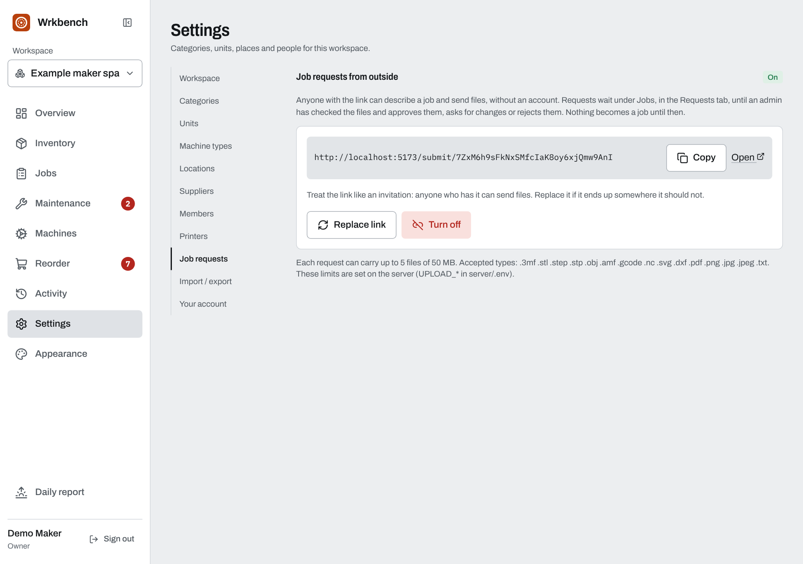
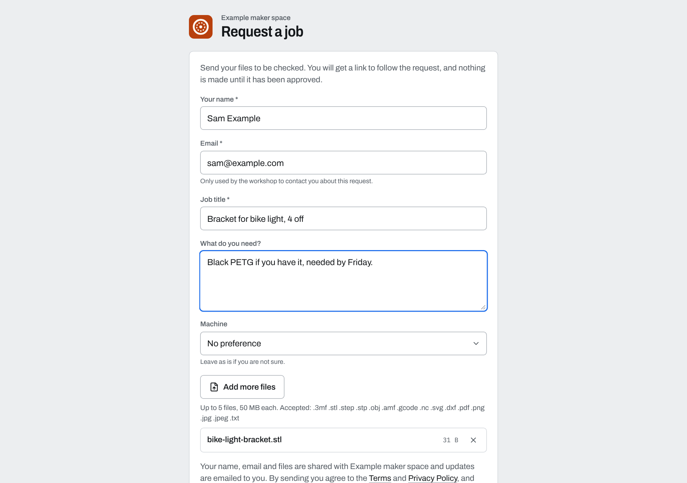
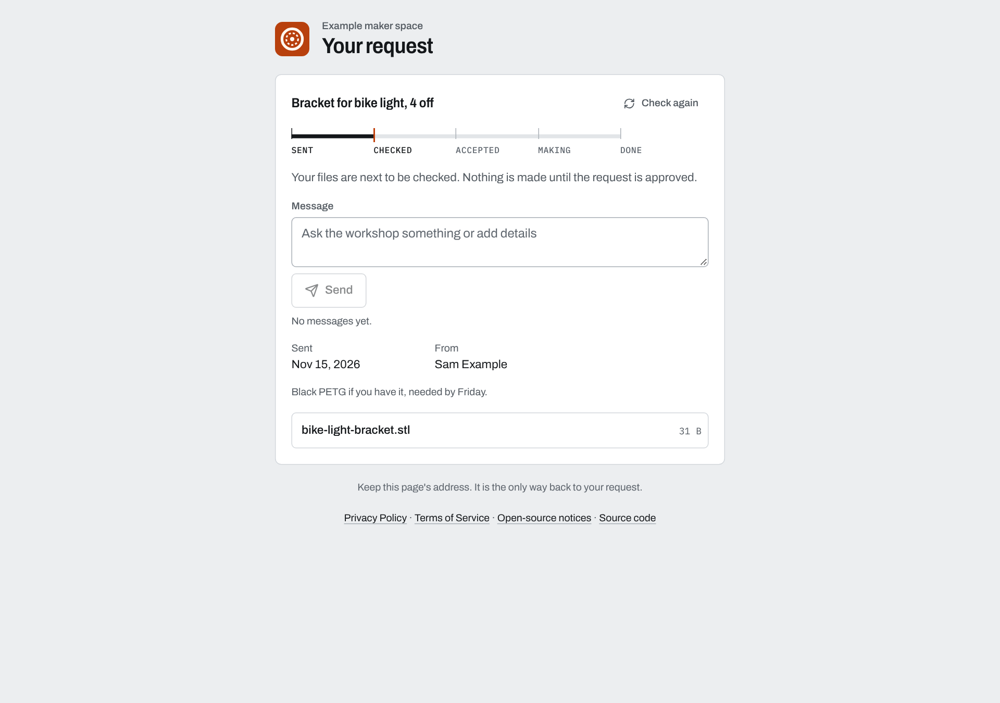
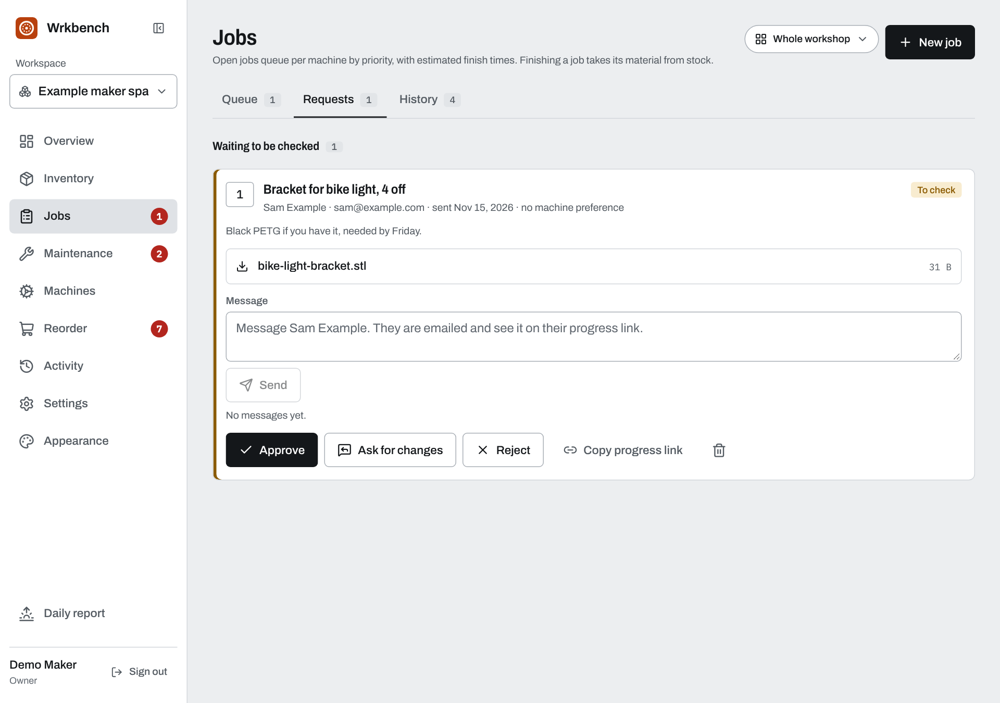

# Job requests

People outside your workshop (students, customers, other teams) can ask for a job through a link, without an account. They send their files, you check them, and they follow progress on a page of their own.

## Turn on the request link

Only an owner can do this.

1. Go to **Settings**, **Job requests**.
2. Turn the link on and copy it.
3. Share it wherever your requesters will find it.

Treat the link like an invitation: anyone who has it can send you files. If it ends up somewhere it should not, press **Replace link**. The old link stops working straight away; requests already sent are not affected. **Turn off** stops new requests altogether.

## What the requester does

1. Opens the link and fills in their name, email, a job title, and what they need (material, colour, quantity, finish, deadline).
2. Optionally picks a machine.
3. Attaches **at least one file**: up to 5 files, 50 MB each by default. Accepted types include 3MF, STL, STEP, OBJ, G-code, SVG, DXF, PDF and images. Any file can be chosen; one of a type that is not accepted is marked in the list, and has to be removed before the request can be sent.
4. Presses **Send for checking**.

They then get a link to follow their request. **That link is the only way back to it**, so they should keep it.

On that page they can see where the request stands, where its job is in the queue, and any messages. They can reply, ask questions, or send new files when changes are asked for.

## Check a request

New requests appear under **Jobs**, **Requests**, oldest first. A red number on **Jobs** in the sidebar counts those waiting.

Download the files, then choose:

| Action | What happens |
| --- | --- |
| **Approve** | Creates a planned job carrying the requester's details and files. Pick the machine and estimated time; add materials to the job afterwards |
| **Ask for changes** | The requester is asked to send new files |
| **Reject** | The request is closed |

Each decision can carry a message. The requester is emailed about it and sees it on their progress page.

An approved request moves to **in progress** when its job starts and to **done** when the job is finished. You can also set these by hand, for work not run as a job.

Members and the requester can comment on a request. The requester is emailed on every status change and every comment from a member.

## Who can do what

- **Owners** turn the link on, replace it and turn it off.
- **Admins** approve, ask for changes, reject and delete requests.
- **Operators** can comment and move a request's status along.

## Good to know

- Emails only go out if whoever runs your copy of Wrkbench has set up email. See [Self-hosting](Self-hosting.md#email).
- Uploaded files are kept on the server and only ever handed to signed-in members as downloads.
- Uploaded files are not included in the workspace export. See [Backups, import and export](Backups-and-data.md).
