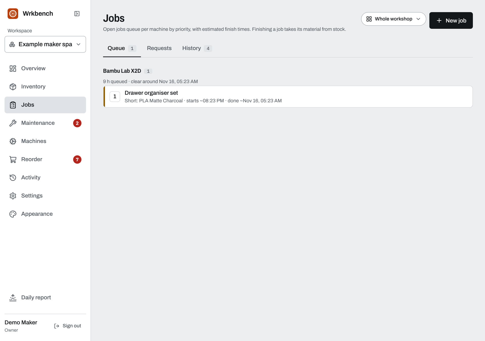

# Jobs and the queue

A **job** is a piece of work run on a machine: a print, a cut, an engraving. A job lists what it uses, so finishing it updates your stock, your tooling and the machine's hours, and records what it cost.

The **Jobs** screen has three tabs:

- **Queue**: open jobs, in the order each machine will run them.
- **Requests**: jobs asked for by people outside the workshop. See [Job requests](Job-requests.md).
- **History**: finished, failed and cancelled jobs, with their cost.

## Create a job

1. Press **New job**.
2. Fill in:
   - **Job name**: what is being made.
   - **Machine** it runs on.
   - **Run time**: how long the machine runs. Added to the machine's hours when the job finishes.
   - **Priority**: **Urgent**, **High**, **Normal** or **Low**.
3. Under **Materials**, add the items it uses and how much of each.
4. Under **Tool wear**, add any tooling that wears (such as an endmill) and its **Cutting time**.
5. Under **Other**, add costs that are not in stock: labour, outsourcing.

Wrkbench shows an **Estimated cost** as you go. If a job needs more of something than you have, it is marked **Short of stock** and appears in the [daily report](Dashboard-and-reports.md#daily-report).

## Run a job

Open a job from the queue:

- **Start** marks it as running.
- **Finish** marks it as completed.
- **Failed** marks it as failed.
- **Edit** changes the quantities if the job used more or less than planned.

## Finish a job

When a job is finished or marked as failed, Wrkbench:

1. takes its materials out of stock,
2. adds its cutting time to each tool (see [Tool life](Inventory.md#tool-life)),
3. adds its run time to the machine (see [Maintenance](Maintenance.md)), and
4. saves its cost: **materials + tool wear + machine time + other**.

A failed run still uses its materials, so they are taken from stock too. Edit the quantities first if less was used.

Machine time is the run time multiplied by the machine's running cost per hour.

## The queue

Each machine's open jobs are listed in the order they will run:

1. the running job,
2. then by priority, from urgent to low,
3. then in the order you set with the arrows,
4. then oldest first.

Start and finish times are estimated from each job's run time, back to back from now. A machine marked **Needs service** or **Offline** pauses its queue.

Operators can create, start, finish and reorder jobs. See [Members and roles](Members-and-roles.md).
