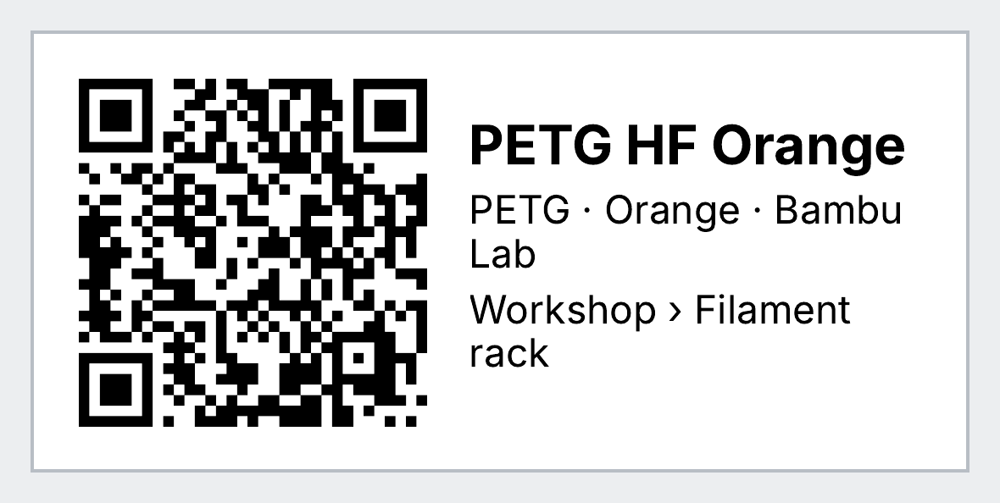

# Labels and scanning

Wrkbench prints a QR label for any item or location. Scanning one opens that item or location, on any phone, so you can check stock, log what you used or put things away without searching.

## What a label holds

The QR code is a link to the item or location in your Wrkbench, and nothing else. It carries no details of the thing itself:

- Someone who is not signed in gets the sign-in page, and after signing in lands on what was scanned.
- Someone who is not a member of the workspace learns nothing: they are told the label is not for anything of theirs.
- If you belong to several workspaces, scanning switches to the right one.

Beside the code the label shows the name, a line of details (for an item: its material, size and so on; for a location: its kind and label code) and where it lives.

## Print labels

Labels are made for a **roll label printer** (Brother, Dymo, and the many thermal printers that take rolls of small labels): each label is its own page.

1. Open what you want a label for:
   - An item: open it and press **Print label**.
   - Several items: in **Inventory**, narrow the list with search or filters, open **Filters**, then **Print labels for these … items** (up to 200 at a time).
   - A location: see [Locations](Locations.md#labels).
2. Choose the **Label size**. Four common sizes are listed; **Another size** takes any width and height from 15 to 150 mm. The size is remembered on that device.
3. Press **Print**. In the print window that opens, choose your label printer, the same paper size, **no margins** and **100% scale**.

The preview shows the first label at its real size. A label taller than it is wide puts the code on top and the text beneath.

> **Print from the address everyone uses.** The link on a label starts with the address Wrkbench was open at when it was printed. The dialog shows that address, and warns when it is one only that computer can open (`localhost`).

Anyone in the workspace can print labels, including viewers.

## Scan with any phone

Point the phone's own camera at a label and tap the link it shows. Nothing needs installing.

## Scan inside Wrkbench

**Scan** (in the sidebar, and at the top right on a phone) opens the camera inside Wrkbench. Hold a label inside the square; it is read as soon as it is sharp.

The in-app scanner does a little more than the phone's camera:

- It reads **your own codes** too. If a product's barcode is in an item's **SKU / barcode** field, scanning the product opens the item. A location's **Label code** works the same way. (Reading ordinary barcodes depends on the browser; QR codes are always read.)
- **Or type a code**: type or paste a label code, SKU or barcode and press **Find**. A USB barcode reader works here as well, since it types the code for you.
- On a location, **Scan items here** keeps scanning and moves each item you scan to that location. See [Locations](Locations.md#put-things-away).
- It reads NFC spool tags on phones that can. See [Spool tags](Spool-tags.md).

The camera only works when Wrkbench is opened at a secure address (one starting `https://`). The first time, the browser asks whether Wrkbench may use the camera. If you said no, allow it in the browser's settings for the site; typing codes works in the meantime.

## After a backup is restored

Labels keep working after a workspace is exported and imported into an empty Wrkbench at the same address: items and locations get the same ids back. Importing into a Wrkbench that still holds the originals makes copies with new ids, so the old labels keep pointing at the originals. See [Backups, import and export](Backups-and-data.md).

## Good to know

- A label stops working when its item or location is deleted. An item that was retired because past jobs used it says so when scanned.
- If Wrkbench moves to a new address, labels printed before the move point at the old one. Keep the old address redirecting to the new one, or reprint.
- Label printing was checked by producing the pages and reading the code back by program. It has not yet been checked on a physical label printer: if your printer cuts off or shrinks the label, check the paper size, margins and scale in the print window first.
