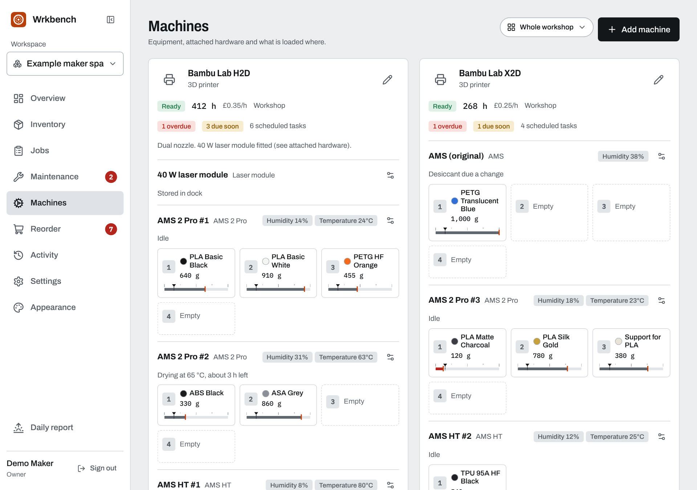

# Machines

The **Machines** screen lists your equipment: printers, lasers, CNC routers, saws, anything you want to track. For each machine you see its status, what is attached to it, what is loaded in it, and whether its maintenance is on track.

## Add a machine

Press **Add a machine**, then choose:

- **From the catalogue**: pick the make and model. It arrives with its specs, its feeders or tool changers, its machine type and that type's maintenance schedules. See [Catalogue and settings](Catalogue-and-settings.md#the-built-in-catalogue).
- **By hand**: for anything not in the catalogue.

Useful fields:

| Field | What it does |
| --- | --- |
| **Type** | Groups similar machines. A maintenance task set on a type applies to every machine of that type |
| **Status** | **Ready**, **In use**, **Needs service** or **Offline**. A machine that needs service or is offline pauses its job queue |
| **Usage hours** | Finished jobs add their run time to this, which drives hour-based maintenance |
| **Running cost per hour** | Added to the cost of each job run on it |
| **Specifications** | Fixed facts worth seeing at a glance: build volume, laser power, spindle speed, bed size |

## Attached hardware and slots

**Attached hardware** is anything fitted to a machine: a filament feeder (such as a Bambu Lab AMS), a tool changer, a dryer, a rotary module. Press **Attach hardware** on a machine's card to add one.

Give it **slots** if it holds material or tooling: a 4-spool feeder has 4 slots, an 8-tool changer has 8. Each slot can have one item from your inventory **loaded** in it.

- Tap a slot to load an item, change it, or unload it.
- Unloading only frees the slot. It never changes how much is in stock.
- One item can only be in one slot at a time. Loading it somewhere else moves it.
- **Readings** (humidity, temperature, pressure) and a **Status note** (for example "Drying at 65 °C, 3 h left") are there for anything you want to see at a glance.

Connected Bambu Lab printers fill in their AMS units and slots by themselves. See [AMS and spools](AMS-and-spools.md).

## A machine's own page

Use **Whole workshop** at the top right to pick one machine. Overview then becomes that machine's page: its status and hours, what is loaded, what is low or worn, its maintenance and its jobs. Inventory, Jobs, Maintenance and Reorder narrow to that machine until you switch back to **Whole workshop**.

## Related guides

- [Maintenance](Maintenance.md): schedules for each machine or machine type.
- [Jobs and the queue](Jobs-and-queue.md): the order jobs run in on each machine.
- [Connecting printers](Connecting-printers.md): live status from Bambu Lab printers.
