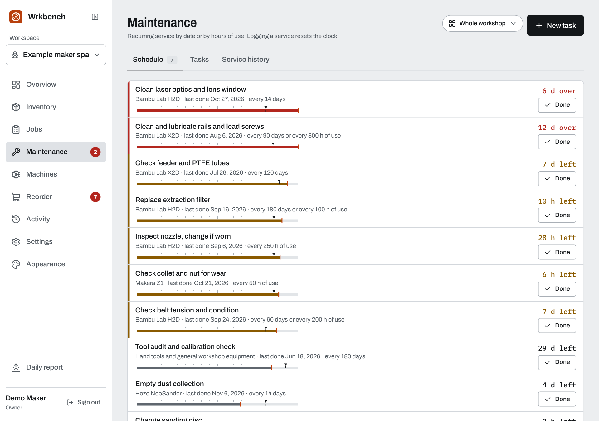

# Maintenance

**Maintenance** keeps track of recurring servicing: cleaning rails, replacing filters, checking belts, termly safety inspections. Each task repeats after a number of days, a number of hours of use, or both, and logging a service starts the clock again.

The screen has three tabs:

- **Schedule**: every task on every machine, most urgent first, with how long is left.
- **Tasks**: the tasks you have defined, to add or change them.
- **Service history**: every service that has been logged.

## Add a task

1. Press **New task**.
2. Name it, for example "Clean and lubricate rails".
3. Under **Applies to**, choose:
   - **One machine**, or
   - **Every machine of a type**: the task then covers every machine of that type, including ones you add later.
4. Set **Every (days)**, **Every (hours of use)**, or both. With both set, the task is due at whichever comes first.
5. Optionally add **Instructions**: what to check and what to use.

Untick **Active** to pause a task: it stays defined, shows as **Paused**, and stops producing reminders.

## When a task is due

A task is due when its days or hours run out, counted from the last logged service of that task on that machine. Hours come from the machine's usage hours, which finished jobs add to.

A new task counts days from today and hours from zero, so a well-used machine may show as due straight away. Log the last service you did with **Done** so the clock starts from the right point.

Overdue tasks are counted in red on the sidebar and appear in the [daily report](Dashboard-and-reports.md#daily-report).

## Log a service

Press **Done** next to a task on the **Schedule** tab, then fill in:

- **Date done** and **Machine hours at service**.
- **Notes**: what was found or changed.
- **Parts used**, if any. These are taken out of stock.

Operators can log services as well as admins. See [Members and roles](Members-and-roles.md).

Removing a logged service makes the task due again based on the service before it. Parts used are not put back into stock.
