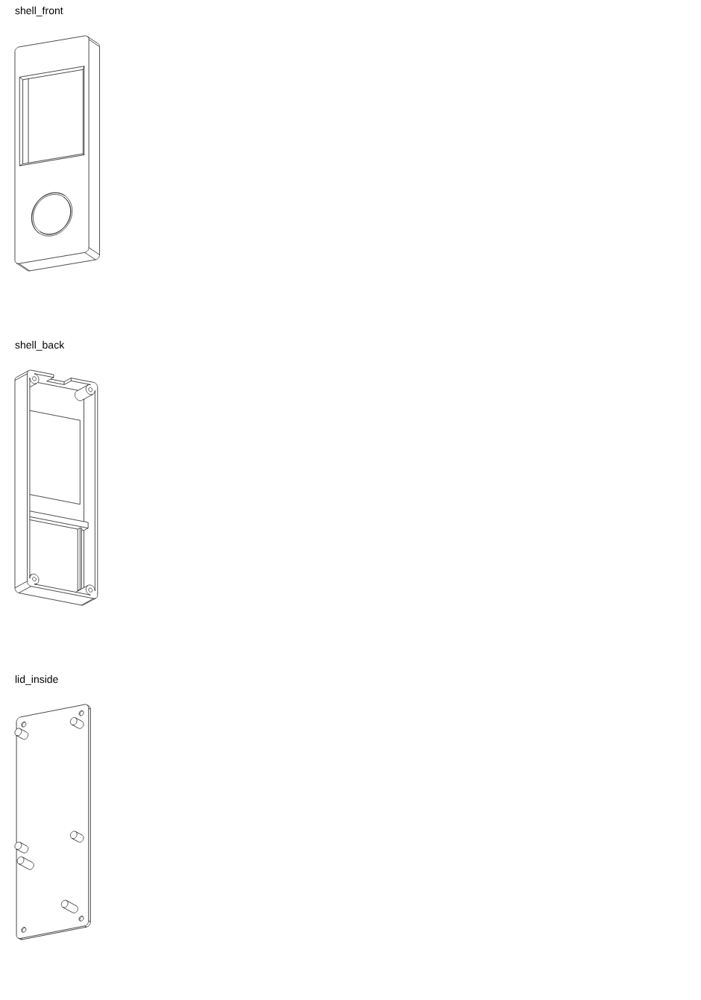

# Case for a location display and its tag reader

A printable case that holds a CYD display board (ESP32-2432S028R) and the red PN532 tag reader side by side: the screen on the left, the reader behind a plain panel on the right, under a ring that shows where to hold a spool.

Outside it is about 152 x 55 x 19 mm.

## Files

| File | What it is |
| --- | --- |
| `shell.stl`, `shell.step` | The front and sides. Print face down, no supports |
| `lid.stl`, `lid.step` | The back, with posts that press the boards against the front. Print flat side down, no supports |
| `fit_test.stl`, `fit_test.step` | The front 3.5 mm of the shell, to check the fit before printing the whole shell |
| `case.py` | The model. Every size is a setting at the top; running it writes the files above |

## Before you print

**The sizes have not been checked against real boards.** They are the commonly published ones for these boards, and boards differ a little between makers. The case has not been printed.

1. With calipers, check the settings marked `MEASURE` at the top of `case.py`: the two boards' width and height, how far the screen's glass stands off its board, and where the lit part of the screen and the USB socket sit.
2. Change any that differ, then run `pip install cadquery` and `python case.py`.
3. Print `fit_test.stl` and try both boards in it. The display board should drop in with the lit area inside the window; the reader should drop in between its rails.
4. Print the shell and the lid.

## Putting it together

You need four M3 x 12 screws. They cut their own thread in the shell's corner posts.

1. Wire the reader to the display board (see [Location displays](../../docs/wiki/Location-displays.md#the-tag-reader)).
2. Lay the shell face down. Drop the display board in, screen down, with its USB socket at the notch in the short wall. Drop the reader in beside it, flat side down.
3. Plug in the USB cable and lay it in the notch.
4. Put the lid on and fit the four screws.

Mount it with double-sided foam tape on the lid. The screws go in from the back, so fit them before it goes on the drawer.

## Good to know

- The reader reads through the 1.6 mm front. Keep `FRONT_T` under 2 mm, and do not print the shell in a filament with metal or carbon in it.
- If your board has its USB socket on the other short edge, turn the board round and set the screen's rotation in the firmware.
- PETG or PLA both work. The window's edges slope outwards, so no supports are needed face down.
